# A7 – FEA on Bracket

## Objective
Use Finite Element Analysis (FEA) to improve the bracket design from previous assignments.
Ensure high stiffness, strength, and lightweight optimization through iterative design.
Conduct multiple FEA simulations, refining geometry based on results.
Perform static stress analysis, including constraints, loading, and meshing selection.
Interpret data by identifying max stress, displacement, and safety factors.
Optimize the design by modifying geometry to enhance performance.
Document the entire process with images, calculations, and insights.
Reflect on key engineering lessons learned and time spent.

## Setting up the bracket
To get the bracket ready for Finite Element Analysis, I added a fixed geometry on the two bottom parts on where it would be theoretically hanging. Then I used a 650 lbf that would be pulling down on the cylindrical hanger part of the bracket.
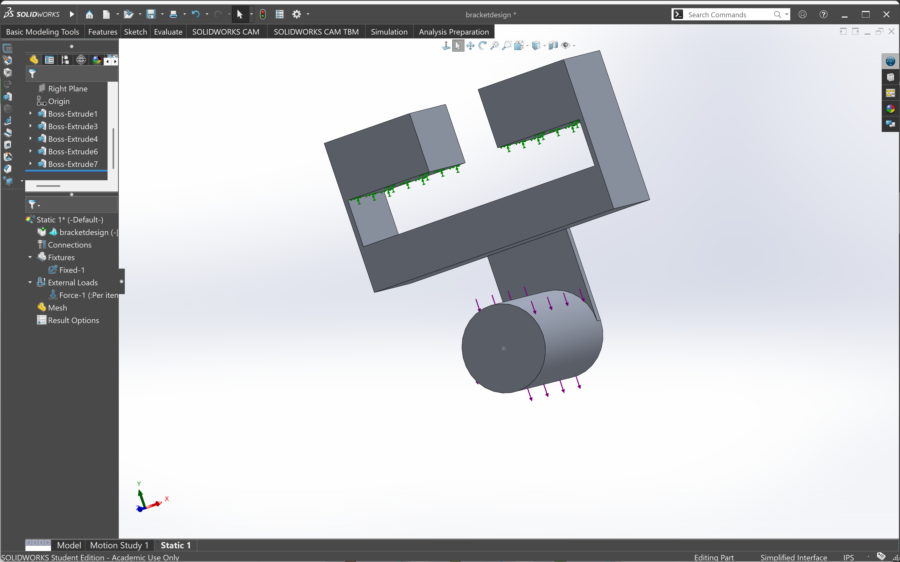

## Design 1
Design 1 utilizes my original design from my previous project. This design is not optimized and will be ran through FEA in order to maximize how much stress it can handle while also reducing the weight 

## Design 1 — Simulation Results

| Mesh | Stress | Displacement |
|---|---|---|
| Coarse | 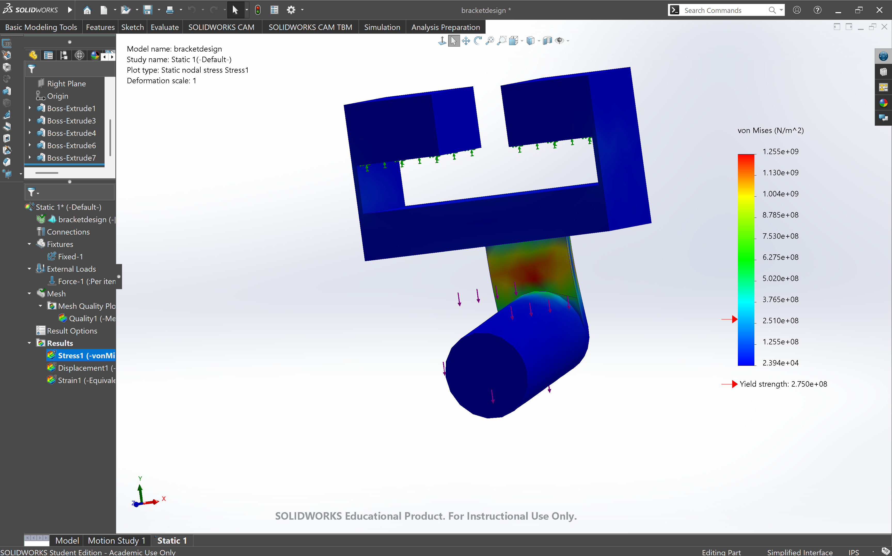 | 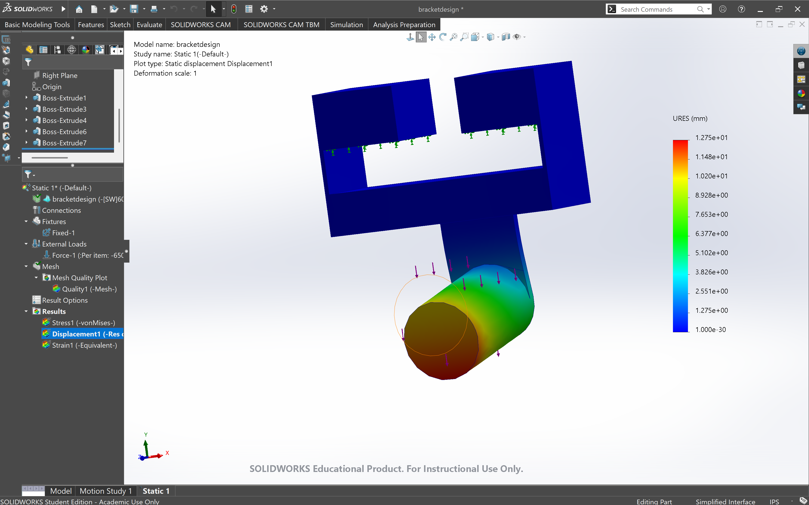 |
| Medium | 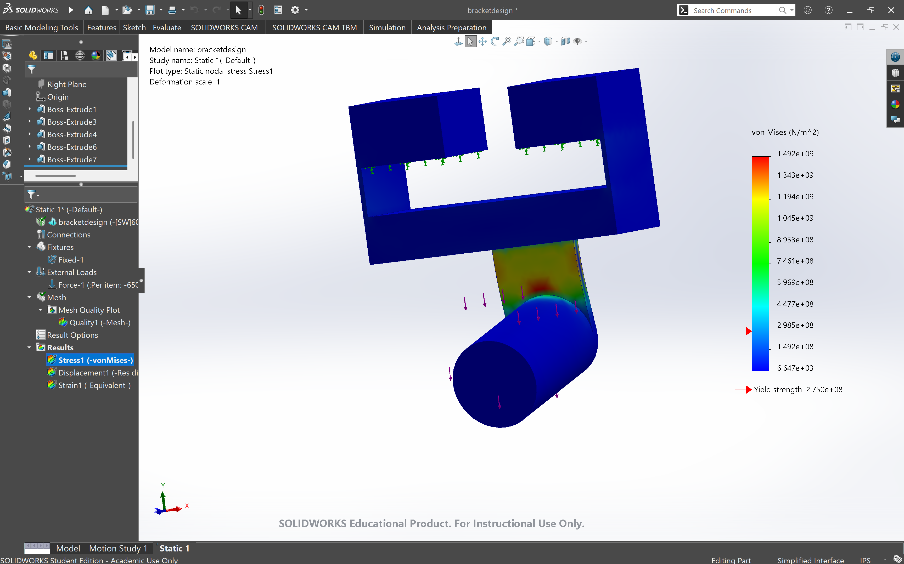 |  |
| Fine | 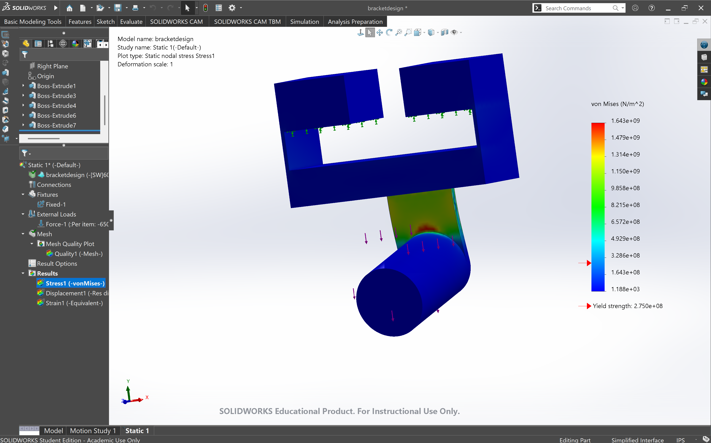 |  |

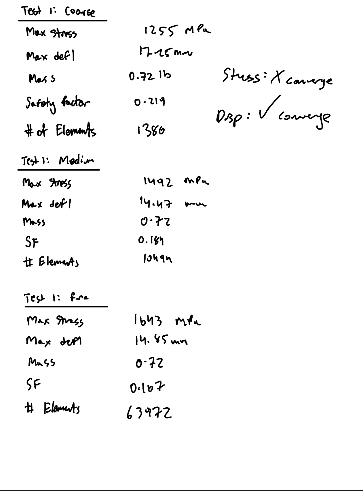

For the coarse mesh, I obtained a maximum stress of 1255 MPa, a maximum displacement of 17.25 mm, and a safety factor of 0.219. The medium mesh gave me a maximum stress of 1492 MPa, a displacement of 14.47 mm, and a safety factor of 0.184. Finally, the fine mesh produced a maximum stress of 1643 MPa, a displacement of 14.85 mm, and a safety factor of 0.167. The mass of the bracket remained constant at 0.72 lb throughout all three tests. Overall, the original design was not strong enough to support the applied load because the maximum stress exceeded the material's yield strength, which gave me a safety factor of below 1. This showed that I needed to modify the geometry to reduce the stress concentration and improve the strength of the bracket.

My % did not meet the required 7% difference.

## Design 2
For design 2, I added a fillet where the cylinder met the connecting part of the bracket as that's where the most stress concentration was and I wanted to smoothen it out. 

## Design 2 — Simulation Results

| Mesh | Stress | Displacement |
|---|---|---|
| Coarse | 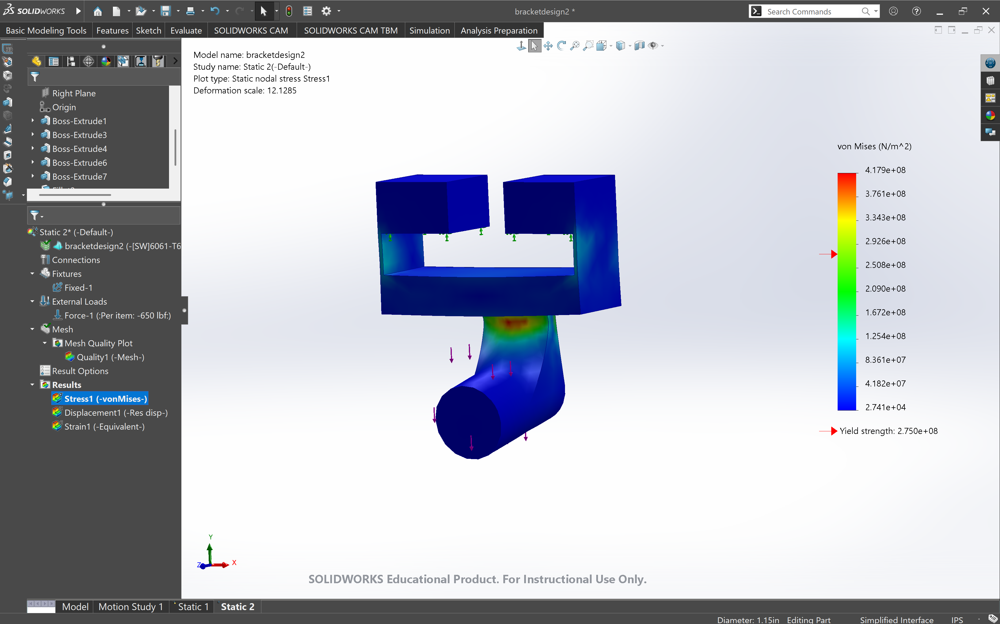 | 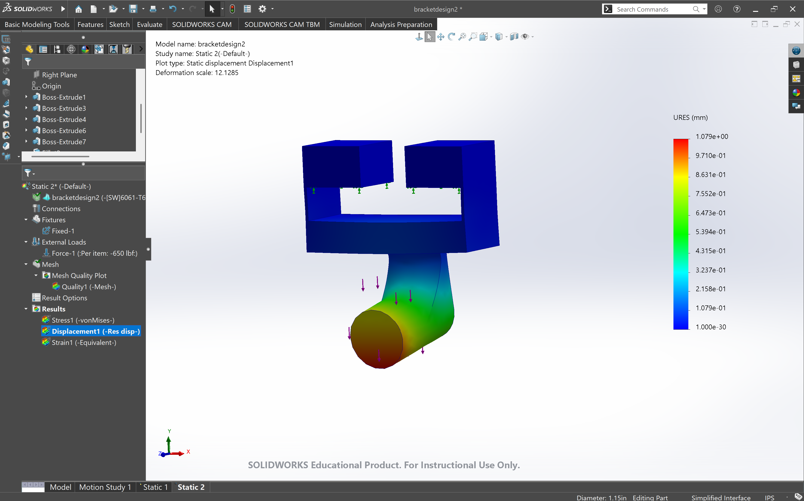 |
| Medium | 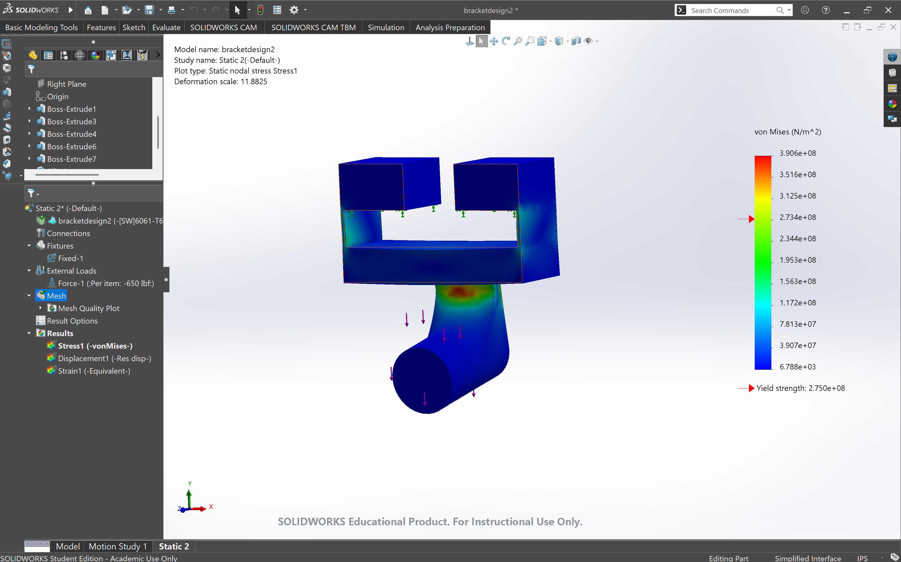 | 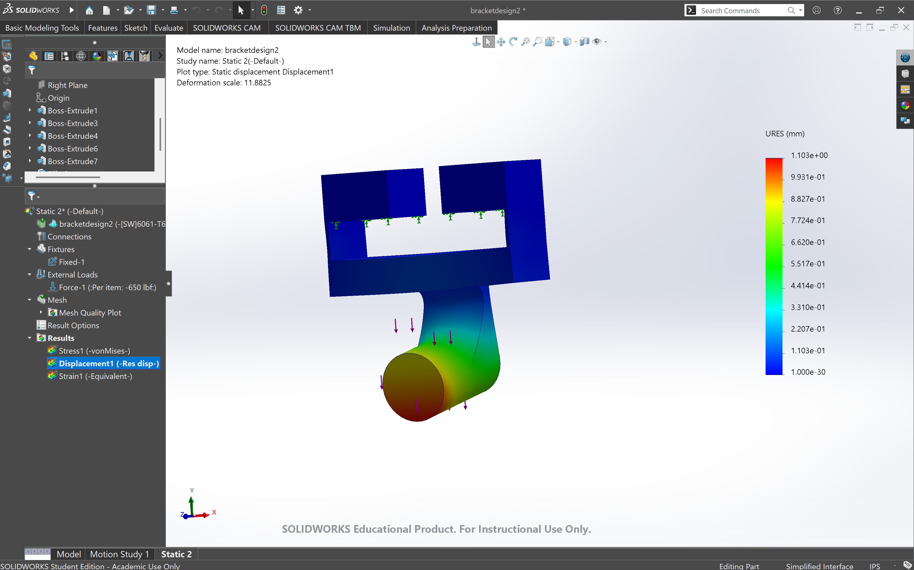 |
| Fine | 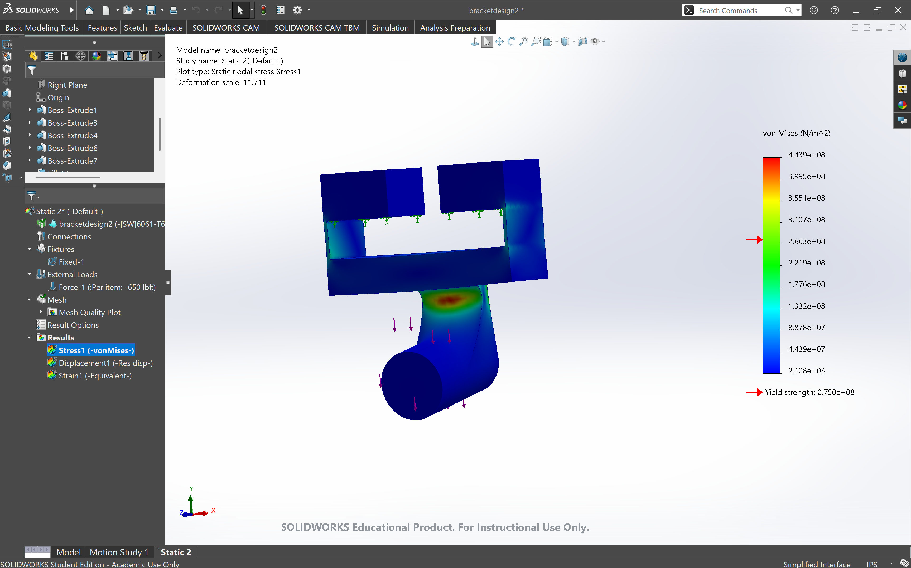 |  |

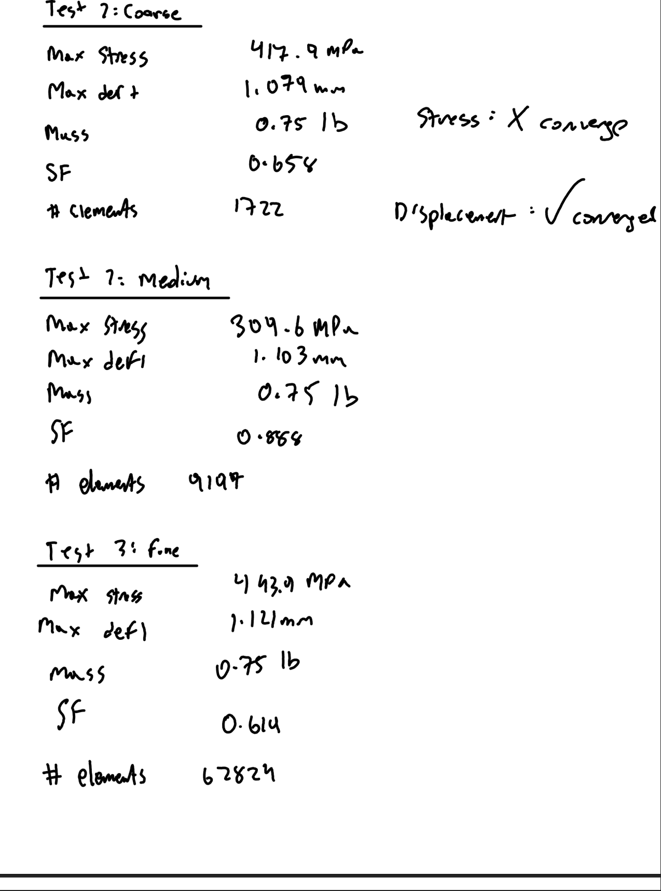

I tested the bracket using coarse, medium, and fine meshes again to compare the results. The coarse mesh produced a maximum stress of 417.9 MPa, a maximum displacement of 1.079 mm, and a safety factor of 0.658. The medium mesh produced a maximum stress of 309.6 MPa, a displacement of 1.103 mm, and a safety factor of 0.888. Finally, the fine mesh produced a maximum stress of 443.9 MPa, a displacement of 1.121 mm, and a safety factor of 0.619. The bracket's mass increased slightly to 0.75 lb due to added material. In the end, my % difference was still below 7% and I needed to refine my design for the third test. However, adding the fillet helped reduce the maximum stress and gave me a step in the right direction.

## Design 3
For my last design, I removed some excess material that didn't have much of an effect on the stress. This shaved my weight down to 0.62 lb. I also added another fillet opposite of the original one and increased the thickness of the original fillet as well.

## Design 2 — Simulation Results

| Mesh | Stress | Displacement |
|---|---|---|
| Coarse | 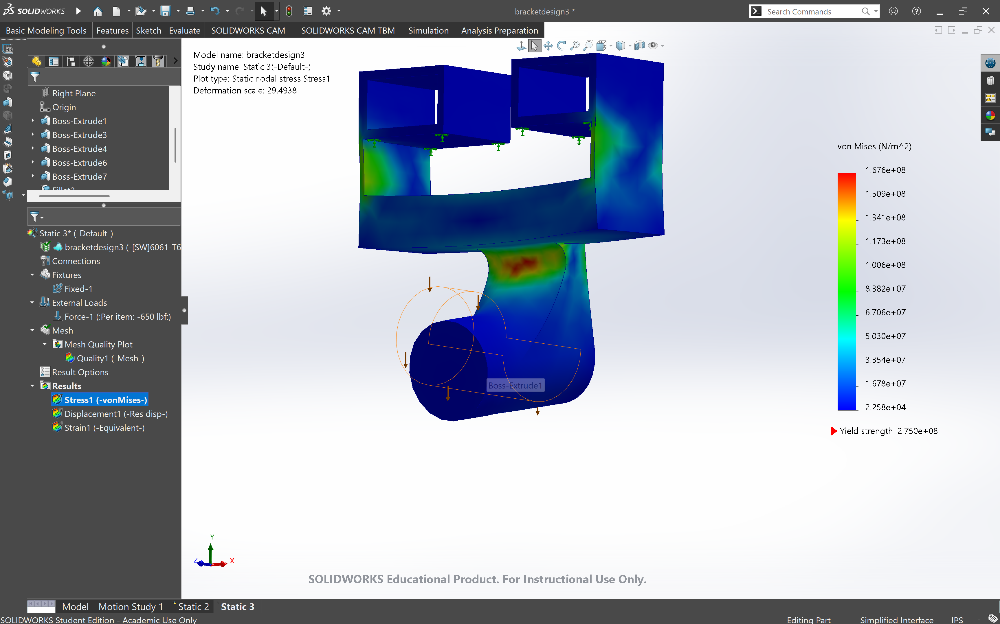 |  |
| Medium | 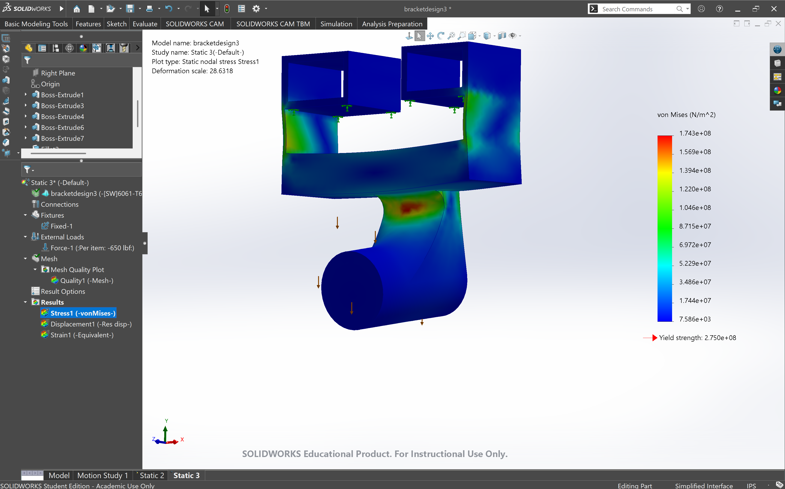 |  |
| Fine |  | 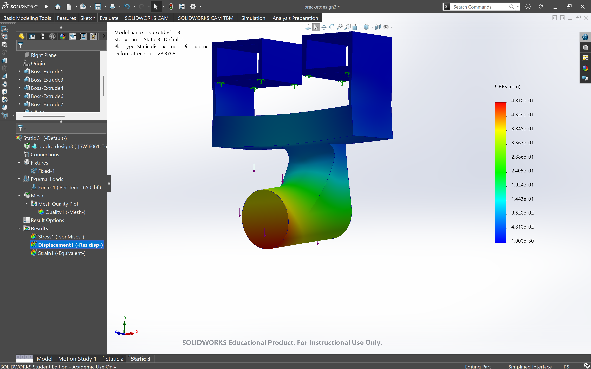 |

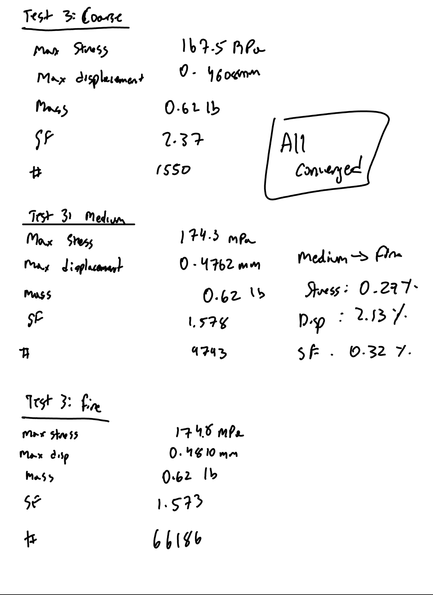

I tested the bracket using coarse, medium, and fine meshes to check for convergence. The coarse mesh produced a maximum stress of 167 MPa, a maximum displacement of 0.46 mm, and a safety factor of 1.647. The medium mesh produced a maximum stress of 174.3 MPa, a displacement of 0.47 mm, and a safety factor of 1.578. Finally, the fine mesh produced a maximum stress of 174.8 MPa, a displacement of 0.48 mm, and a safety factor of 1.573. The final bracket had a mass of 0.62 lb, which was lower than both of my previous designs. When comparing the medium and fine meshes, the maximum stress changed by only 0.29%, while the displacement changed by 2.13%. The safety factor also changed by approximately 0.32%. All three results were within the required 7% convergence limit, meaning my final design successfully converged.

The third design was the most successful as all my values converged and the weight, maximum stress, and deflection was all reduced. My safety factor also increased to 1.573 meaning the max calculated stress was below the material's yield strength.

## Conclusion

One of the biggest mistakes I made during this assignment was applying the force in newtons instead of pounds force at first. Because of this, my original simulation results were incorrect, and I had to go back and redo the tests using the correct 650 lbf load and this set me back a little bit. This taught me how important it is to double check the units and simulation settings before running an analysis. Another difficulty I experienced was getting my results to converge. During my first two designs, the stress values changed drastically between mesh sizes, even though the displacement values were converging. At first, I did not fully understand why this was happening, but I learned that mesh size can have a large effect on the calculated maximum stress, especially near areas with stress concentrations.

This assignment took me about 4 hours to complete.

## CAD FILES

