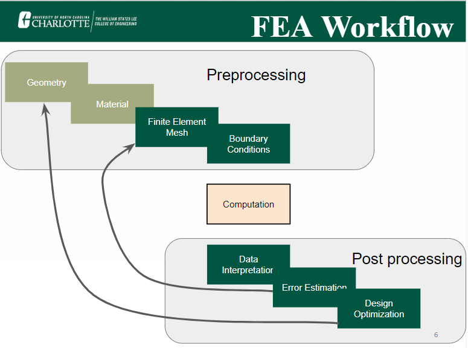

# A7 – FEA on Bracket

## Objective
Use Finite Element Analysis (FEA) to improve the bracket design from previous assignments.
Ensure high stiffness, strength, and lightweight optimization through iterative design.
Conduct multiple FEA simulations, refining geometry based on results.
Perform static stress analysis, including constraints, loading, and meshing selection.
Interpret data by identifying max stress, displacement, and safety factors.
Optimize the design by modifying geometry to enhance performance.
Document the entire process with images, calculations, and insights.
Reflect on key engineering lessons learned and time spent.

## Setting up the bracket
To get the bracket ready for Finite Element Analysis, I added a fixed geometry on the two bottom parts on where it would be theoretically hanging. Then I used a 650 lbf that would be pulling down on the cylindrical hanger part of the bracket.

## Decide

## Communicate

