# A8 – Gears

Objective
Design a gearbox that can be assembled and disassembled.
Analyze and size input and output shafts for strength.
Design journal bearings to support shafts.
Create a gearbox housing with proper clearance and fastening.
Use parametric CAD modeling to generate a final design.
Document calculations, sketches, and lessons learned.

Description:

Design a gearbox which can be assembled and disassembled. The spur gears have a gear ratio of 24:9 and are listed in the resource section. The output gear torque and speed are to be 1.25 in-lbf and 1100 rpm relative. The input (pinion,power-transmission) and output (gear, short shaft) shaft diameters are .125 and .25 inches respectively and each have a length of 1 inch. Use the appropriate equations in the Machinery’s Handbook for empirical units. The critical features of the gearbox include the shafts, and the journal bearings.

Assumptions:

Assume appropriate strength of shafts, use Machinery’s Handbook.
The gear train is ideal.
The moment of the radial force from the gear train is small enough to be ignored.

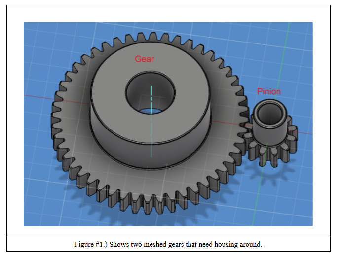

## Calculations

The required gear ratio was 24:9, which is equal to 2.667:1. I used the McMaster-Carr 18 tooth and 48 tooth spur gear. This gear ratio provides the required speed reduction and the torque increase.

The gears have a pitch diameter of 0.375 inches and 1.000 inch. I used that to calculate the center distance separation and I got 0.6875 inches.

I selected two different shaft diameters based on the gear requirements. The input shaft has a diameter of 0.125 inches, while the output shaft has a diameter of 0.250 inches and both shafts are 1 inch long. The shafts were designed to be pressed fit through their respective gear hubs to prevent movement between the shafts and gears.

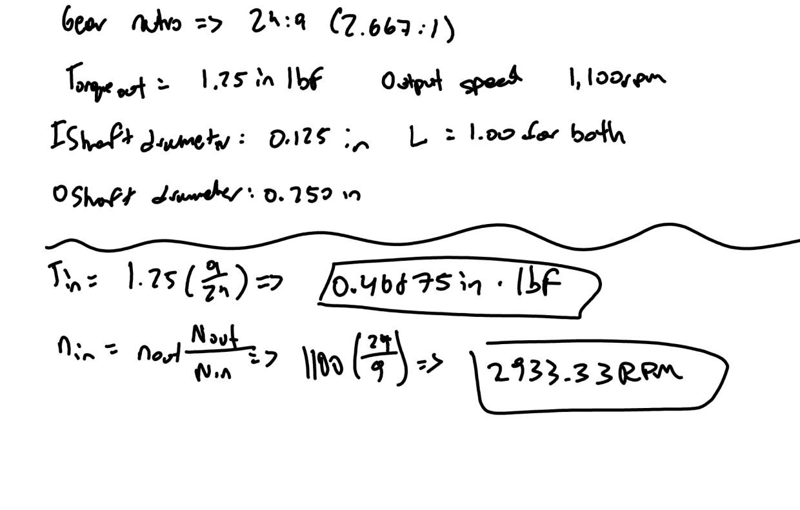
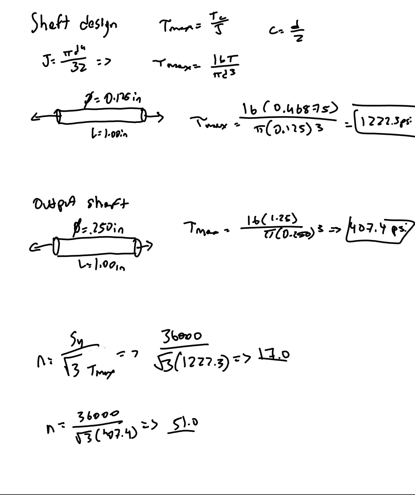

The output speed was specified to be 1100 RPM and then the input speed was calculated using the 2.667:1 gear ratio.
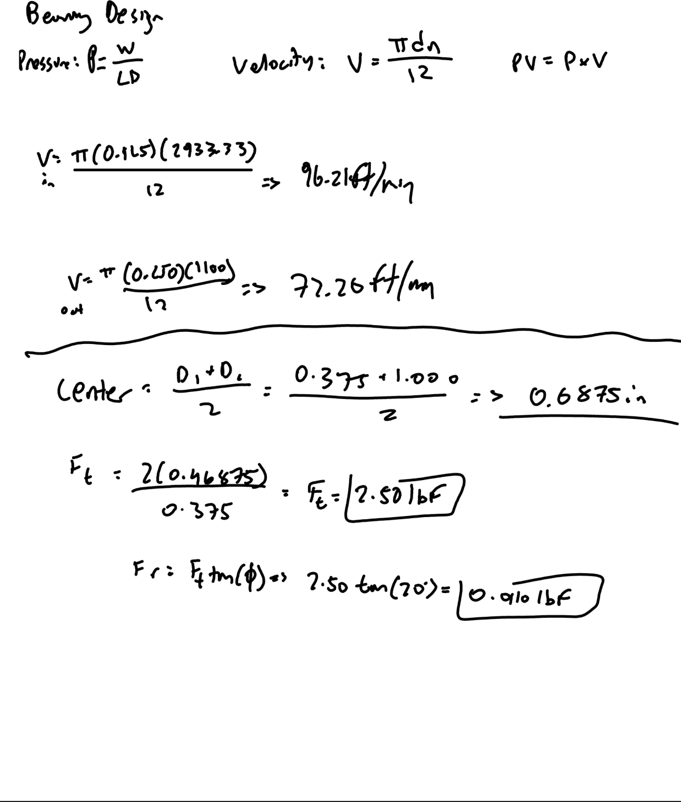

The output torque is greater than the input torque because the gearbox reduces rotational speed.
The tangential force was calculated to be 2.50 lbf and the radial force was 0.910 lbf.

For the journal bearings, I used McMaster part number 6391K111 (input) and 6391K131 (output)
The I.D. was 0.125 inches and 0.250 inches while the O.D. was 0.250 inches and 0.375 inches.

## Design

Once I had all of my calculations, it was time to start designing the gear box. 

First I used the 18 tooth gear as the input gear and the 48 tooth gear as the output gear. I positioned the gears parallel to each other and established a center distance of 0.6875 inches. This allowed the gear teeth to mesh properly and provided the required 2.667:1 gear ratio.

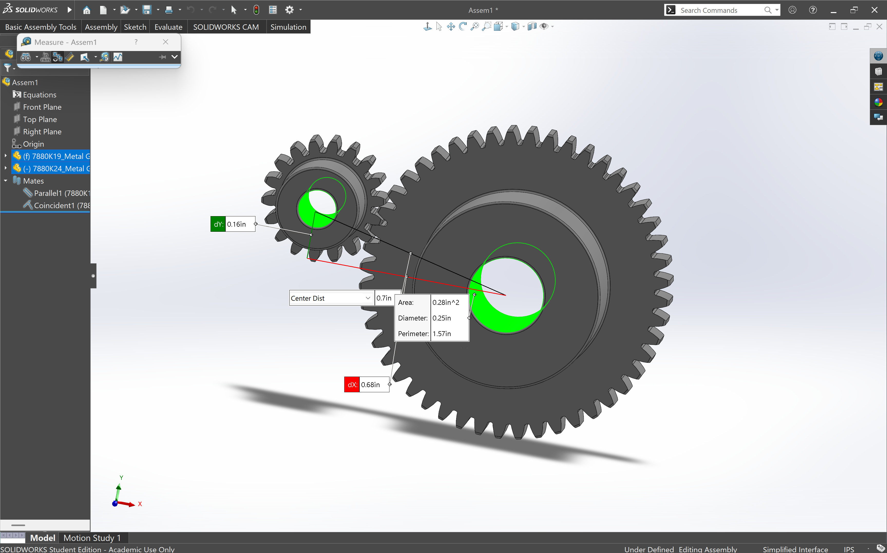

After I positioned the gears, I created the input and output shafts. The input shaft had a diameter of 0.125 inches while the output shaft had a diameter of 0.250 inches and both were 1.00 inches in length. Then, I inserted both shafts into the gear bores.
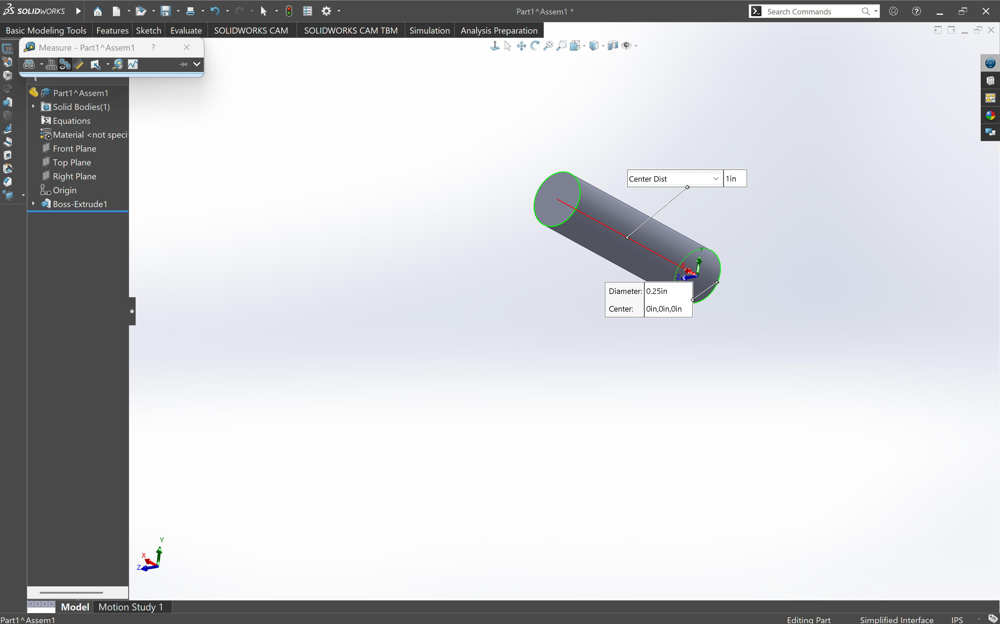
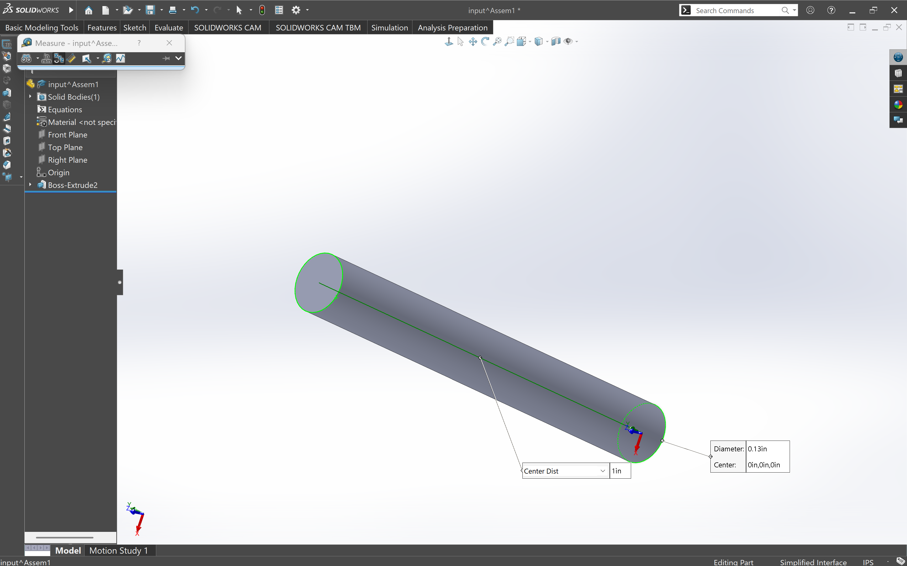
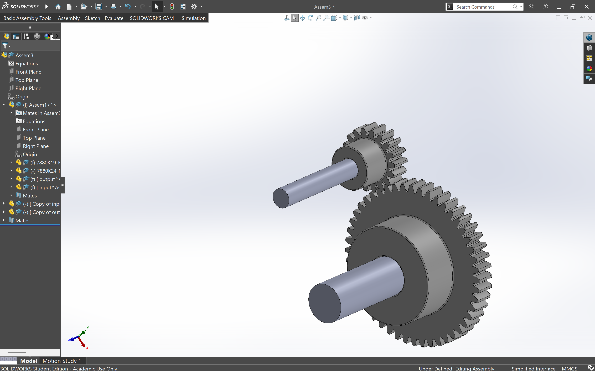

Once that was done, I inserted two journal bearings into the assembly, one for each shaft. I selected bearings with inside diameters matching the shaft diameters and used concentric mates to position them around the shafts. I placed the bearings behind the gears to provide support letting both the shafts stick out from the gearbox.

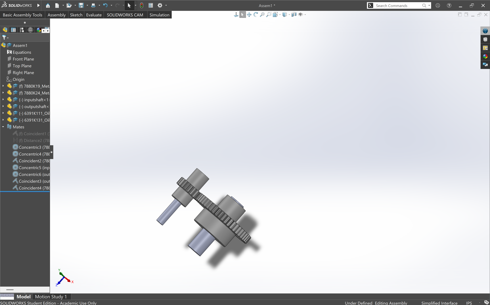

After the gear assembly was complete, I moved onto designing a gearbox housing in a separate SolidWorks part. I chose to use a single piece main housing and a removable cover. This gave the gears an enclosed space yet still allowed for maintenance and assembly access.

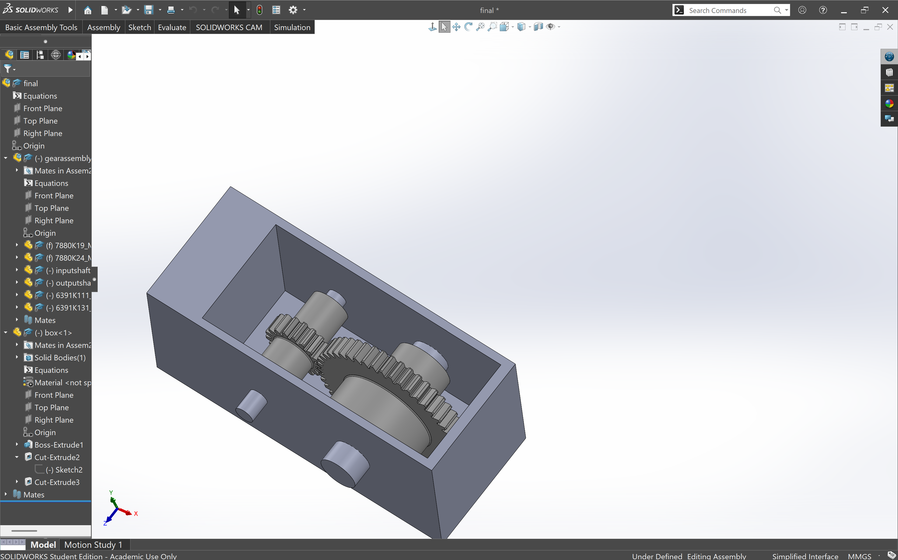

The housing was designed with enough internal clearance for the gears to rotate without interference. I also accounted for the bearing locations and added openings for the shafts to extend through the housing walls. The final design is intended to use a removable cover secured with bolts, allowing the gearbox to be opened without removing the entire housing.

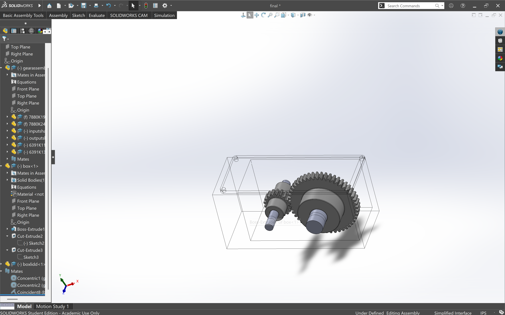

## Lessons Learned
One of the biggest things I learned during this project was the importance of constraining components properly in SolidWorks assemblies. I initially had difficulty positioning the gears because I was using concentric mates between the two gears. This took me a decent amount of time to figure out and set me back a little bit. I learned that concentric mates align components along the same axis, while a distance mate is needed to establish the correct center-to-center spacing between parallel shafts.

I also learned how important it is to consider the physical arrangement of components before designing the housing. The gear positions, shaft lengths, bearing locations, and housing openings all need to work together. Making changes to one component can affect the dimensions and placement of the others. I had a couple unfortunate over constraints that I had to fix.

Overall, this project helped me improve my SolidWorks modeling and assembly skills. It also helped me with gear ratios, torque transmission, shaft sizing, bearing selection, and housing design. I also learned that designing a functional mechanical assembly requires more than making individual parts and that each component must fit and function correctly as part of the complete system.  

This assignment took me 5 hours to complete, most of it being CAD

[Final Assembly](final.SLDASM)
