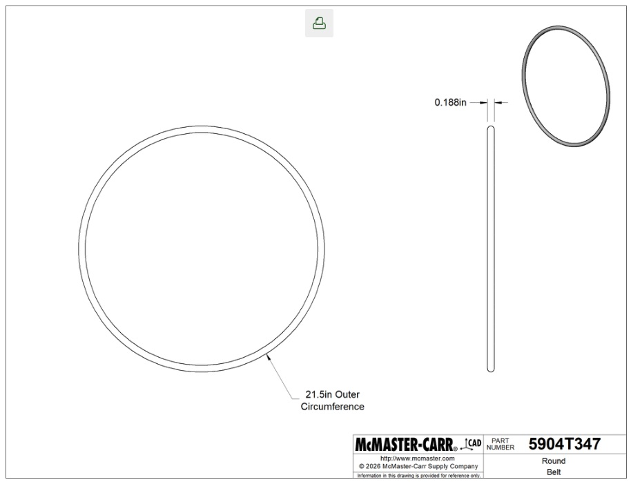
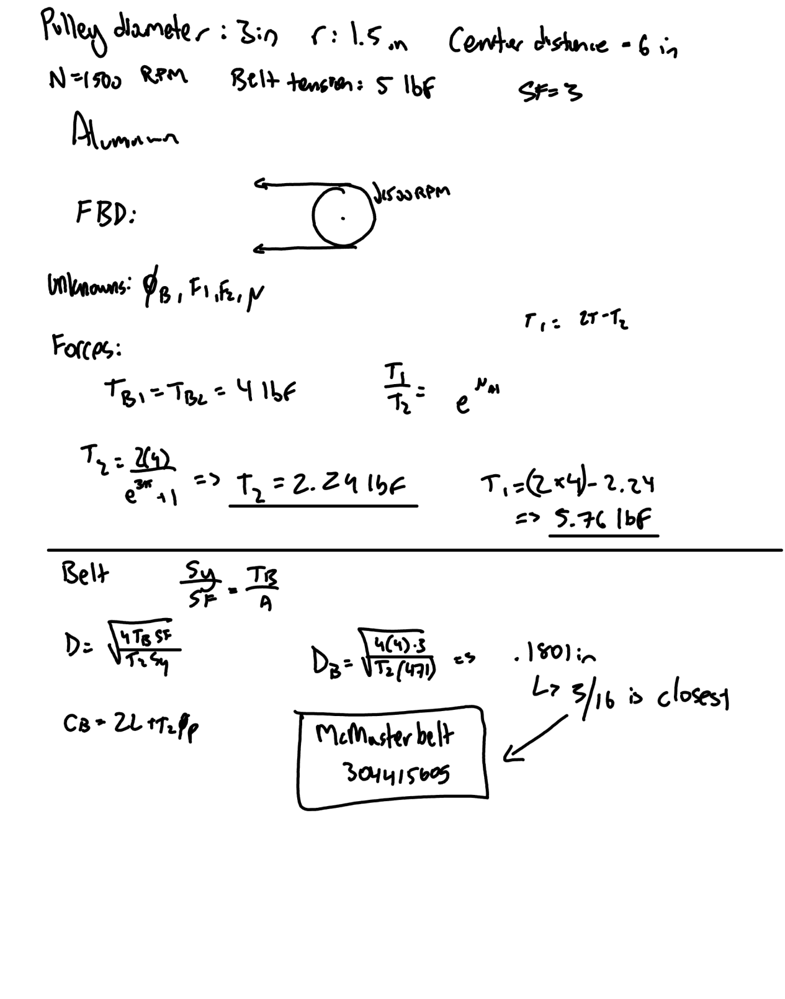
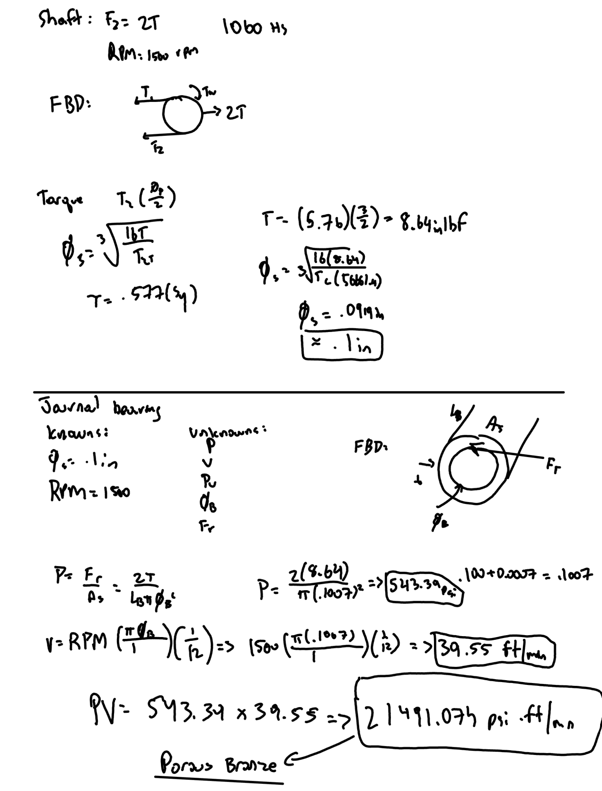
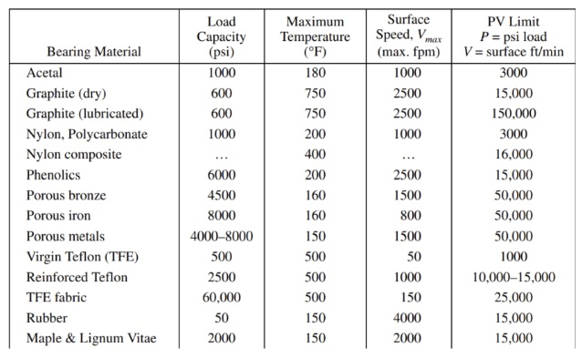
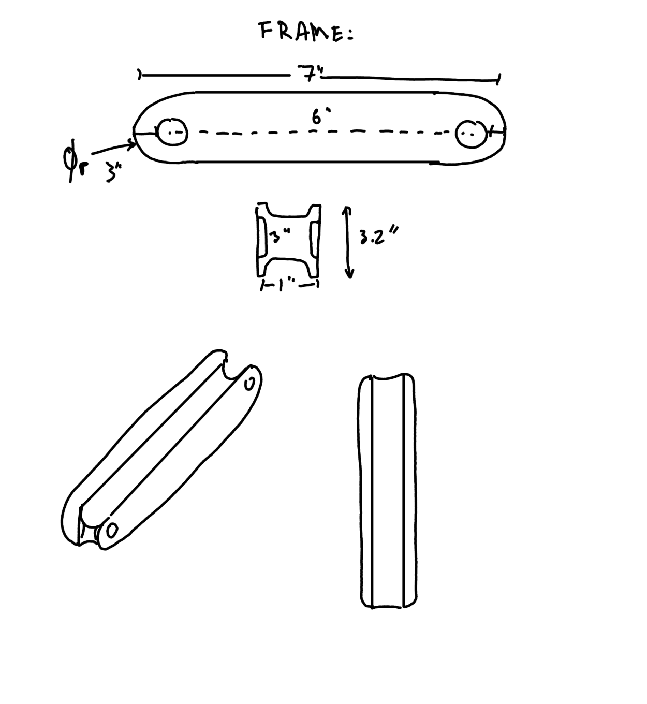

# A9 – Pulleys
Design a pulley system to transfer power between two parallel axes separated by a center distance of 4–6 inches. The system must meet the following requirements:

Pulley Diameter: Both pulleys shall have a diameter of 3 inches.
Rotational Speed: Select an operating speed between 1000–2000 rpm.
Belt Tension (Static): Select a belt tension between 4–6 lbf under stationary conditions.
Material: Pulleys may be made from aluminum, ABS, or steel, and may include a groove and shaft diameter of your choosing (within reasonable manufacturing limits).
Safety Factor: The design must satisfy a minimum safety factor of 3.
Assume the belt is made from polyurethane rubber, with a yield strength of 3.25 MPa (471 psi) at 20% strain, based on: Wanga, Chena, Wua, Zhangb, Suna, “Strain-induced Structural and Dynamic Changes in Segmented Polyurethane Elastomers.”

## Selecting the belt
The goal was to find a belt that would be in the pulley system. First, I listed out the knowns and unknowns and drew out the Free Body Diagram. For RPM speed, I chose 1500 RPM and for the center distance, I chose 6 inches. The pulley material I chose was aluminum which had a safety factor of 3. To find the belt that was required, I needed to find the diameter and circumference. I did the work to find the tension forces which gave me T1 = 5.76 lbf and T2 = 2.24 lbf. Using Tb1 = 4 lbf, I was able to find the diameter of the belt which is .1801 inches. This was closest to 3/16 and that lined up with McMaster-Carr belt 3044K605

## Shaft and Journal Bearing 
To design a shaft that would fit into the pully I followed a similar outline as the belt selection process. First thing I did was list my knowns and unknowns and drew a similar free body diagram to that of the belt and pully diagram. To find the diameter for the shaft I used torque and shear stress equations. Doing so gave me a value close to .125", so I used this as the shaft diameter.
Next, I needed to design a shaft that would fit into the pulley. I started with a FBD again and found the torque and diameter values. For the torque, I got 8.64 in lbf and for the diameter I got 0.919 inches which I ended up just rounding up to .100 inches. 

For the journal bearing, I started out by listing my knowns and unknowns and drawing my Free Body Diagram. First, I had to solve for pressure which netted me 543.39 psi. Next, I solved for velocity, which I got 39.55 ft/min. After multiplying both of them together, I got 21491.074 psi * ft/min. Using that value, I figured that porous bronze would be an appropriate choice for materia.

## Frame Design

For the frame I decided to add some walls to prevent belt slip

## Lessons Learned 
Throughout this project, I learned how multiple mechanical engineering concepts work together when designing a pulley system. One important idea was the relationship between belt tension and torque. The difference between the tight and loose side tensions determines how much torque is able to be transferred through the pulleys. I also learned that increasing belt tension does not necessarily mean increasing the system's efficiency because it can increase loads on the bearings and shafts

In total, this assignment took me 3 hours.

## Work PDF
[Downloadable PDF](work.pdf)

